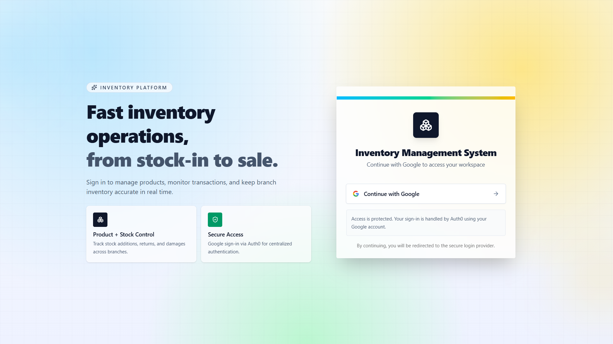
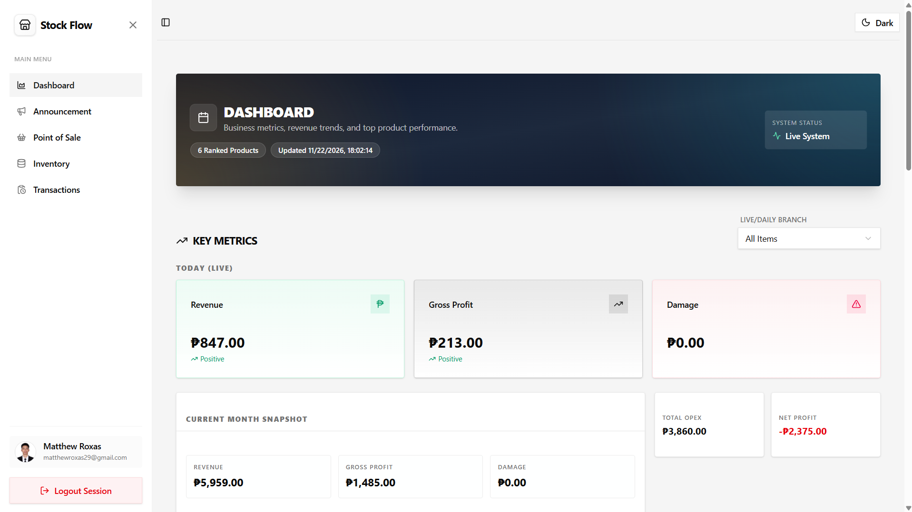

# Inventory Management System

A web-based inventory and point-of-sale system for managing products and stock across branches. It brings day-to-day inventory operations, sales, and business reporting into one application.

## What it can do

- Organize products by category and branch, with stock levels tracked per product.
- Record sales, purchases, returns, and damaged stock.
- Review transaction history and stock movements.
- Track operating expenses.
- View product, branch, daily, and monthly reports.
- Authenticate users through Auth0, update the interface in real time, and run scheduled reporting and cleanup jobs.

## Screenshots

  
  

## Technology

- **Frontend:** React, TypeScript, Vite, Tailwind CSS, TanStack Query, Auth0
- **Backend:** Node.js, Express, TypeScript, Prisma, Socket.IO
- **Data and jobs:** PostgreSQL, Redis, BullMQ
- **Deployment:** Docker, Docker Compose, Render

## Repository

- [`frontend/`](frontend/): browser application
- [`backend/`](backend/): API, database schema, and background jobs
- [`docs/`](docs/): setup guide and project documentation

## Documentation

Start with the [setup and documentation guide](docs/README.md) for local development, Docker, database migrations, demo data, and deployment. The [backend README](backend/README.md) and [frontend README](frontend/README.md) describe their respective applications and link back to the relevant setup steps.

## License

Apache-2.0
